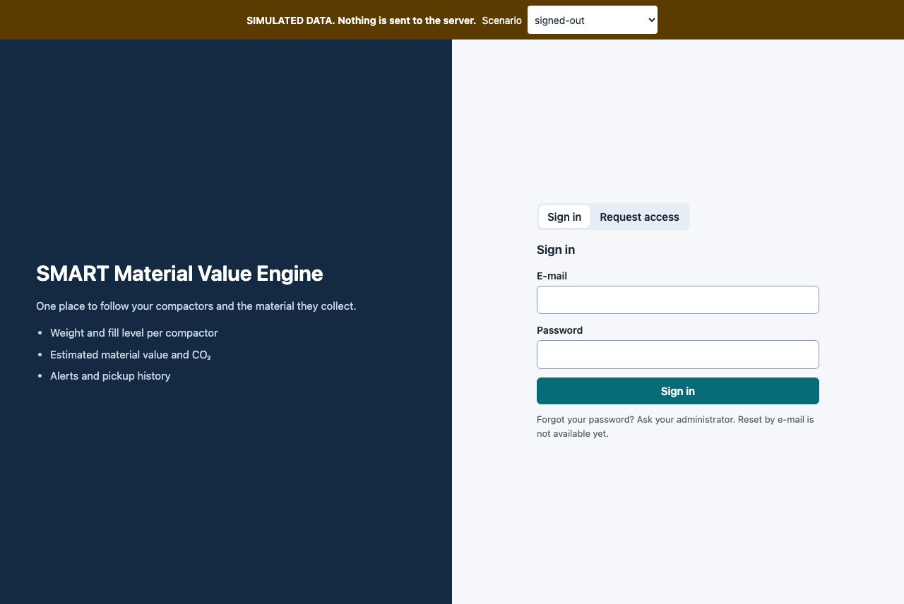
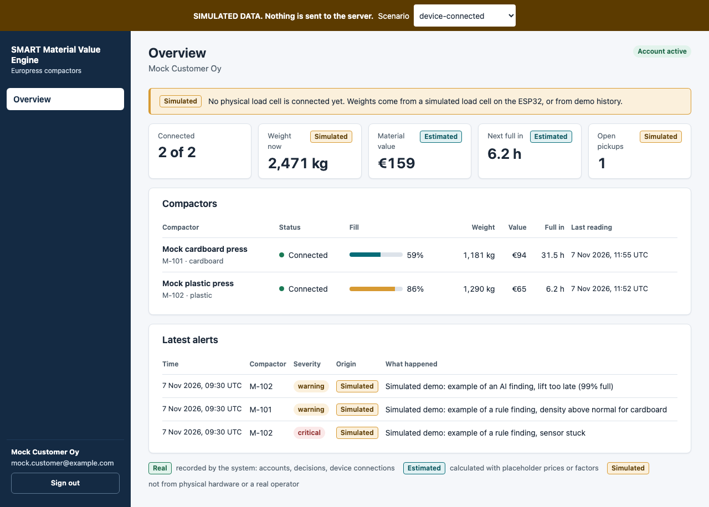
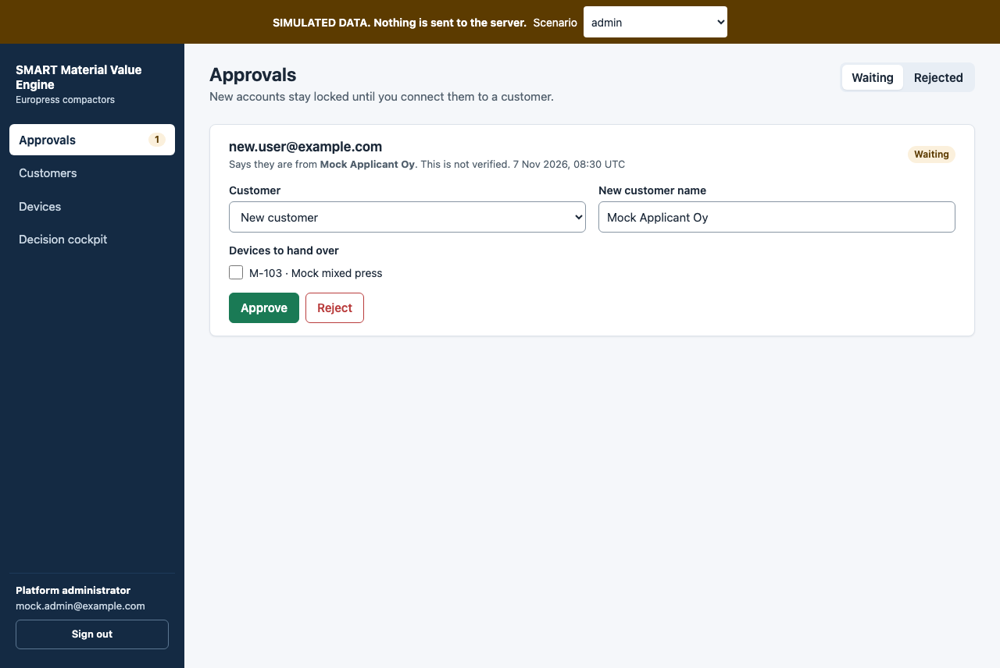
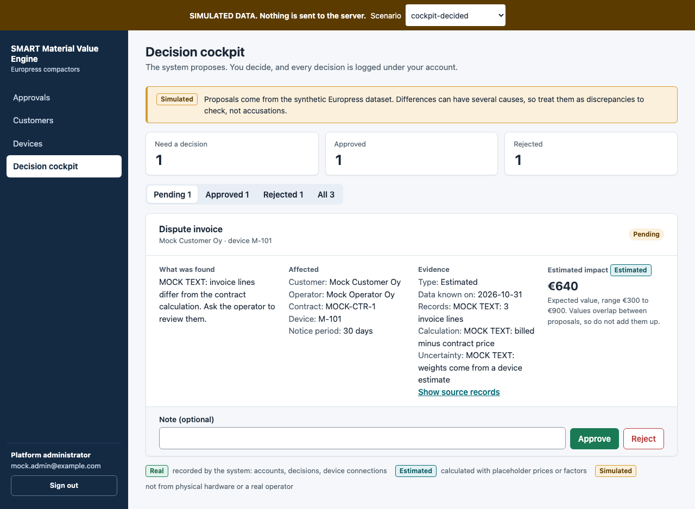
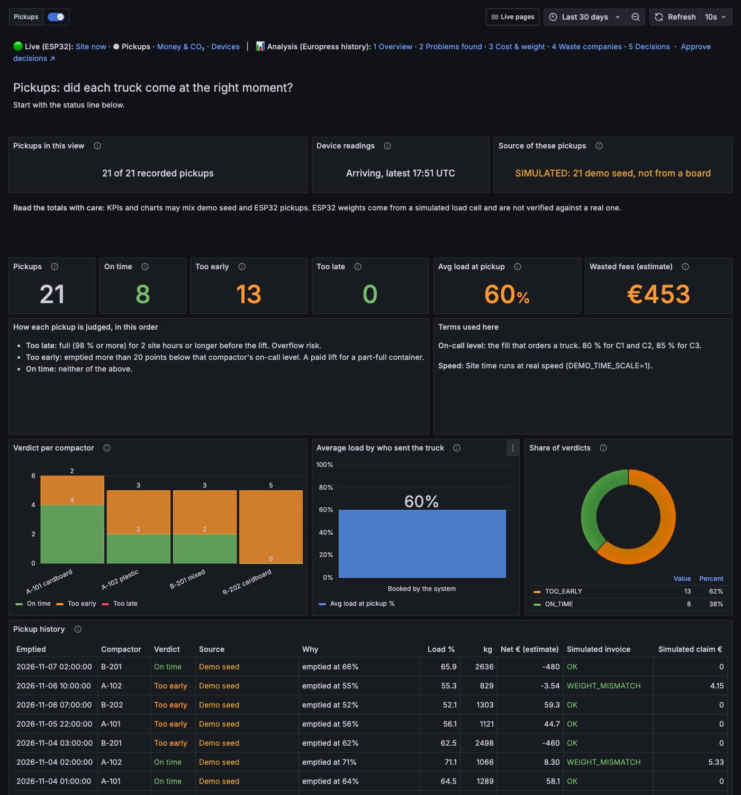

# Gửi Nam: nhánh `feature/live-pickups-ux` có gì

Nhánh này biến hệ thống từ màn hình cho admin thành nền tảng nhiều khách hàng: có đăng nhập, phân quyền và giao diện mới.
Nó tách từ commit `3cfdb30` của `feature/compactor-framework`. `main` và nhánh của Nam không bị đụng đến.

## ⚠️ Đọc trước khi merge

**Nhánh này chưa có commit `f4f653b` của Nam** (Manual truck booking, customer prices, live Analysis). Commit đó lên sau khi nhánh này được tách.
Chưa ai gộp hai bên. Thử merge cho thấy 5 file xung đột, và có vài chỗ không xung đột về Git nhưng vẫn hỏng khi chạy.

### Vấn đề bảo mật phải sửa khi gộp

`backend/app/access.py` là placeholder và tin các header do client gửi:
- Không có header thì được coi là admin, nếu `ADMIN_API_KEY` rỗng.
- Ai cũng tự gửi được `X-User-Role: customer` và `X-Customer: <tên khách khác>`.

Nhánh này cho khách hàng vào thẳng cổng 8000 để dùng Portal, nên **nếu gộp nguyên trạng, khách hàng đọc được `/api/analysis/*` của nhau**.

Cách sửa: thay `who_is_asking` bằng `auth.current_user`, rồi lấy tên khách hàng từ phiên đăng nhập, không lấy từ header. Rà thêm `/api/pickups/board`, vì route này chưa kiểm tra đăng nhập.

### 5 file xung đột

| File | Nên làm |
|---|---|
| `docker-compose.yml` | **Giữ `GF_AUTH_ANONYMOUS_ENABLED=false`**, vì org 1 có dữ liệu mọi khách hàng. Giữ `GF_PANELS_DISABLE_SANITIZE_HTML` nếu vẫn nhúng trang Book truck. Khách hàng là Viewer nên không sửa được panel |
| `backend/app/main.py` | Giữ router của cả hai bên: `auth`, `tenants`, `analysis`, `booking`, `prices`, cùng `/assets`, `/portal`, `/dev/*` |
| `CONTRACT.md` | Giữ cả hai phần |
| `grafana/make_live_pages.py` | Lấy nội dung trang của Nam, rồi đưa lại `--out`, `--only`, `DEMO_TIME_SCALE` từ môi trường và trang Live 2 mới, với nội dung Nam quyết định |
| `grafana/dashboards/live_pickups.json` | Không sửa tay. Sinh lại từ generator với `DEMO_TIME_SCALE` đúng của máy |

### Không xung đột nhưng sẽ hỏng

| Chỗ | Lý do |
|---|---|
| `backend/app/seed_demo.py`, `dev/fixtures.json`, form Add device | Vẫn dùng vật liệu `plastic`. Nam đã đổi sang `biowaste` |
| Live 2 và trang khách hàng | Vẫn hiện hóa đơn và claim. Nam đã bỏ claim-back ở trang live |
| Live 2, dòng "Terms used here" | Luật phán định vẫn đúng với code của Nam, nhưng nên ghi rõ giờ người dùng bấm đặt xe |
| `backend/app/verify_isolation.py` | Vẫn kiểm tra uid `value-cockpit`, `cockpit-findings`. Nam đã đổi tên các trang này |
| Bảng mới `invoices`, `invoice_lines`, `invoice_decisions` | Chưa nằm trong các view `tenant_api`, nên khách hàng không đọc được qua Grafana. Muốn cho xem thì thêm view có lọc |
| `book.html`, `prices.html`, `invoices.html` | Hàm ghi cần `X-API-Key`. Compose nhánh này đặt key cho Node-RED, nên cần kiểm tra các trang này gửi key thế nào, và không để lộ key ra trình duyệt |

**Đề xuất:** gộp trên một nhánh mới, như `integration/platform`, rồi chạy phần kiểm thử ở cuối file trước khi đưa vào `main`.

## Có gì mới

```
Khách hàng ─► Portal (:8000/portal) ─► API, chỉ thấy thiết bị của mình
Khách hàng ─► Grafana org riêng ─────► Postgres role riêng ─► view tenant_api
Admin ──────► Portal, Cockpit ───────► duyệt tài khoản, thiết bị, quyết định
Admin ──────► Grafana org 1 ─────────► toàn bộ dashboard và dữ liệu
ESP32 ──────► MQTT ─► Node-RED ─► backend     (giữ nguyên, Node-RED chỉ gửi thêm key)
```

| Phần | Làm gì | Ở đâu |
|---|---|---|
| Đăng nhập, phân quyền | Đăng ký, admin duyệt, phiên đăng nhập, lọc API theo khách hàng | `backend/app/auth.py`, `tenants.py` |
| Cách ly khách hàng | Mỗi khách có Grafana org và Postgres role riêng, chỉ đọc view đã lọc | `provision.py`, `migrations/` |
| Portal | Giao diện khách hàng và admin | `static/portal.html`, `static/assets/` |
| Cockpit | Admin duyệt đề xuất, nhật ký ghi đúng email | `static/cockpit.html` |
| Dashboard khách hàng | 7 trang, tự tạo khi duyệt, không sửa JSON tay | `grafana/make_tenant_pages.py` |
| Live 2 · Pickups | Làm lại bố cục, có dòng trạng thái và cột nguồn dữ liệu | `grafana/make_live_pages.py` |
| Mock mode | Phát triển giao diện không cần board | `static/dev/` |

**Sửa cách ly:** vì Viewer của Grafana gửi được SQL tùy ý, cách ly nằm ở Postgres, không ở biến dashboard.

**Nhãn dữ liệu:** Real là hệ thống ghi nhận, Estimated là tính từ giá tạm, Simulated là không từ phần cứng thật. **Hiện chưa có cân nặng nào là Real**, vì load cell được mô phỏng trong firmware. Khi có load cell thật, sửa theo mục "Data labels" trong tài liệu chi tiết.

## Hình ảnh

Các ảnh có băng vàng SIMULATED DATA là mock mode, dữ liệu trong đó là giả.

**Đăng nhập**



**Khách hàng**



**Admin duyệt tài khoản**



**Cockpit**



**Live 2 · Pickups, chạy thật với dữ liệu demo seed**



## Chạy thử

Lệnh dưới đây chạy nhánh này nguyên trạng, chưa có commit `f4f653b`.

```powershell
git fetch origin
git switch feature/live-pickups-ux
python scripts/init_env.py        # thêm mật khẩu còn thiếu vào .env, giữ giá trị sẵn có
docker compose up -d --build
docker compose exec backend python -m app.seed_demo   # 2 khách hàng demo, không bắt buộc
```

Máy Nam đã có volume Grafana cũ, nên phải đặt lại mật khẩu admin. Lấy `GRAFANA_PASS` trong `.env`:
```powershell
docker compose exec grafana grafana cli admin reset-admin-password "<GRAFANA_PASS>"
```

| Trang | Địa chỉ | Tài khoản |
|---|---|---|
| Portal | http://localhost:8000/portal | `admin@compactor.local`, mật khẩu `PLATFORM_ADMIN_PASSWORD` |
| Cockpit | http://localhost:8000/cockpit | Như trên |
| Grafana | http://localhost:3000 | `admin`, mật khẩu `GRAFANA_PASS` |
| Khách hàng demo | Cả hai | `customer1@demo.local`, `customer2@demo.local`, mật khẩu trong `.env` |

**Những điều dễ bất ngờ:**
- Grafana bắt buộc đăng nhập, không còn xem ẩn danh.
- C1, C2, C3 chưa có chủ. Vào Portal, mục Customers, để gán cho một khách hàng.
- `init_env.py` không đổi `DEMO_TIME_SCALE`. Giữ 60 khi demo với board.
- **Live 2 ghi tốc độ theo lúc sinh file.** File trong repo ghi `DEMO_TIME_SCALE=1`, nên phải sinh lại trên máy Nam:
  ```powershell
  python grafana/make_live_pages.py --out grafana/candidates --only live_pickups
  copy grafana\candidates\live_pickups.json grafana\dashboards\live_pickups.json
  ```
- `grafana/dashboards` được mount vào Grafana, nên file ghi vào đó có hiệu lực sau vài giây.
- Không chạy `make_live_pages.py` không có `--only` nếu chưa chắc scale, vì lệnh đó ghi đè cả 4 trang Live.

## Đã kiểm thử gì

| Kiểm thử | Kết quả | Ghi chú |
|---|---|---|
| Backend pytest | 67 đạt, 1 bỏ qua | Bỏ qua vì image không có `sklearn` |
| `app.verify_isolation` | 170/170 | Grafana, Postgres và API thật |
| Trình duyệt, Mock | 225/225 | Chỉ với dữ liệu mock |
| Trình duyệt, Live | 30/30 | Chạy trước khi tạo nhánh Live 2; phần Portal và Cockpit không đổi từ đó |
| Live 2 sau áp dụng | Đạt | Grafana local, 1400px và 390px |

**Chưa kiểm thử, cần máy Nam:**
- Dữ liệu ESP32 thật trên Portal và Live 2.
- Cột Source với pickup thật từ board. Nếu quy tắc `done_at = ts` không khớp, trang hiện `NOT VERIFIED`.
- Trang phân tích và Cockpit với dữ liệu Europress. 22 panel `cp_*` chưa chạy được.
- Các lệnh Windows trong tài liệu, vì được viết trên Mac.
- **Toàn bộ phần gộp với `f4f653b`.**

## Hạn chế còn lại

- **MQTT không có đăng nhập:** ai vào được cổng 1883 đều đọc và ghi được số đo của mọi khách hàng. Sửa cần đổi cấu hình firmware. Giữ cổng này trong mạng riêng.
- Chưa có HTTPS, xác minh email và quên mật khẩu.
- Khách hàng đăng nhập hai lần, ở Portal và Grafana.
- Trên Rahti vẫn bật ẩn danh. Đừng tạo khách hàng ở đó.
- KPI trên Live 2 cộng chung demo seed và ESP32. Trang có ghi chú, và cột Source tách từng dòng.

## Sau khi gộp, chạy lại

```powershell
docker build -f backend/Dockerfile -t sc-backend-test .
docker run --rm -v "${PWD}/backend:/t" -w /t sc-backend-test python -m pytest -q
docker compose exec backend python -m app.verify_isolation
```
Cần thêm test: khách hàng không đọc được `/api/analysis/*` của khách khác, kể cả khi tự gửi header `X-User-Role` và `X-Customer`.

## Tài liệu chi tiết

- [`docs/FRONTEND_HANDOFF_NAM.md`](docs/FRONTEND_HANDOFF_NAM.md): kiến trúc frontend, mock mode, API, 16 bước kiểm tra phần cứng.
- [`docs/MULTI_TENANT.md`](docs/MULTI_TENANT.md): cách ly, onboarding, cách hoàn tác.
- [`grafana/candidates/README.md`](grafana/candidates/README.md): cách sinh và áp dụng Live 2.
