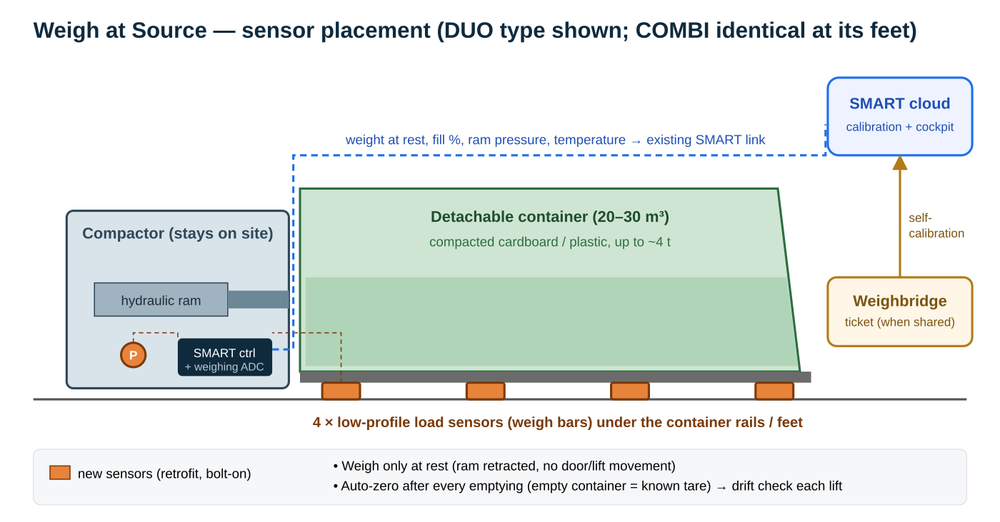

# Part 1 — Weigh at Source: an affordable weighing concept for Europress compactors

**Team:** Hackathon-2026 · Since AI Hackathon 2026 · Europress Group challenge
**Status:** concept + simulation evidence. No physical prototype, no live-machine test (as allowed by the brief).
Every cost below is an **indicative estimate** (catalogue-level ranges), not a quote.

## 1. What accuracy do we actually need?

We used the organisers' tool `examples/weighing_accuracy_value.py` on the competition dataset (10,342 shared single-load
weighbridge tickets as reference) to find the **business-relevant** accuracy before choosing a sensor:

| Concept accuracy (1σ, % of load) | 2.5–3.5 t loads within ±100 kg | Median €/t error | Detects +10 % invoice tonnage | False alarm on correct invoices |
|---:|---:|---:|---:|---:|
| 1.0 % | 99.8 % | 0.85 % | 94.7 % | 0.8 % |
| **1.5 %** | **98.3 %** | **1.1 %** | **95.0 %** | **1.0 %** |
| 2.0 % | 90.4 % | 1.4 % | 94.8 % | 1.6 % |
| 3.5 % | 65.9 % | 2.4 % | 75.6 % | 1.9 % |
| 5.0 % | 50.5 % | 3.4 % | 46.7 % | 1.8 % |

*Source: synthetic dataset v1.0.1, simulated error model — `simulated`.*

**Conclusion:** the design target is **σ ≤ 1.5 % of the load (≈ ±45 kg at 3 t)**. That meets the challenge target
(about ±100 kg on a 3 t load, ≥ 95 %) and is enough to **verify operator tonnage**. Plain €/t reporting would already
work at ~3.5 %, so even a degraded sensor still gives value.
For comparison, today's device mass estimates in the dataset differ from the weighbridge by a median of 2.8 % but
**p95 = 25 %** (sensor faults, drift, side waste, outdated truck tares) — so **fault detection matters as much as raw accuracy**.

## 2. Sensing options compared

| Option | How it works | Expected accuracy* | Indicative cost / unit* | Retrofit | Main risks |
|---|---|---|---|---|---|
| **A. Load sensors (weigh bars / compression cells) under container rails or feet** ✅ | Measure the container's weight force directly at 4 support points | 0.5–1.5 % | €350–900 | Bolt-on under rails/feet; container height +3–5 cm | Side forces, uneven ground, water/ice, impact during lift |
| B. Strain gauges bonded/welded on the frame | Measure steel deformation of the support frame | 2–5 % | €150–350 | Easy, invisible | Temperature drift, per-unit calibration, creep, fatigue |
| C. Hydraulic pressure of the compaction ram | Ram pressure rises as the container fills | Weak for mass (measures resistance, not weight); good for fill/density | €40–90 (often already present) | Trivial | Depends on material, temperature, oil |
| D. Truck hook-lift / onboard truck scale | Weigh when the truck lifts the container | 1–2 % | High, on the operator's truck | Not Europress-owned | Data stays with the operator → defeats the purpose |
| E. Estimate from fill level × density model only | Software only | 10–30 % | ~€0 | Nothing | Density varies by material and season |

\*Estimates from typical industrial component ranges; to be confirmed in the validation experiment (§6).

**Choice: A + C + software (hybrid).**
- **A** gives the mass at rest (primary signal).
- **C** (ram pressure, already in the hydraulic circuit) + fill level are **plausibility checks**: if mass rises but
  pressure/fill don't, something is wrong (e.g. snow on the container, side load, faulty cell).
- **Software** does auto-zero, self-calibration and fault detection (§4). Option B is our fallback for units where
  rail-mounted sensors are mechanically impossible.

## 3. Placement and installation

| | DUO (compactor stays, container is taken) | COMBI (whole unit is taken) |
|---|---|---|
| Where | 4 weigh bars under the **container rails/guides** at the docking position; the container rests on them when docked | 4 cells in the **feet / skids** of the unit |
| Cable | Fixed cable from sensors to the compactor's SMART controller (sensors stay on site) | Short cable + connector that survives transport, or sensors on a ground frame that stays on site |
| Install time (est.) | 2–3 h, 2 people, no welding on the container | 2–3 h |
| Weighing moment | Only **at rest**: ram retracted, door closed, no lift in progress, 30 s stable | same |

**Indicative bill of materials (per compactor):**

| Item | Est. cost |
|---|---:|
| 4 × low-profile load sensors / weigh bars, 2–5 t class, IP67 | €240–600 |
| 4-channel 24-bit weighing amplifier/ADC + junction box | €40–120 |
| Hydraulic pressure transducer 0–250 bar (if not already fitted) | €40–90 |
| Temperature sensor (for drift compensation) | €5–10 |
| Cabling, protection plates, mounting | €40–100 |
| Connectivity | €0 — uses the existing SMART controller/modem |
| **Hardware total** | **≈ €370–920 (target < €500 at volume)** |
| Installation + calibration (≈ 2–3 h) | ≈ €150–250 |

## 4. Calibration (three layers)

1. **Factory / first install:** 2-point calibration with reference weights (e.g. 0 kg and a 1,000 kg IBC of water) and an
   eccentric-load check (weight placed at each corner).
2. **Auto-zero after every lift:** after an emptying, the container is (almost) empty, so the reading must return to its
   known tare. A residual > 50 kg → flag (residue, frozen material, or sensor drift). This gives a **free drift check every lift**.
3. **Self-calibration against shared weighbridge tickets** *(only when the operator shares them)*:
   a robust ratio `median(weighbridge_net / device_kg)` over the last ~10 single-load tickets per device. If it moves by
   > 2σ, we **flag for service** instead of silently re-scaling — so a wrong truck tare at the weighbridge cannot
   "calibrate away" a real difference. The device weight is **never** used as a billing basis today; it is independent evidence.

## 5. Error sources and how we handle them

| Error source | Effect | Mitigation |
|---|---|---|
| Temperature (−25…+30 °C) | zero/span drift | temperature sensor + compensation; auto-zero each lift |
| Uneven ground, side forces from docking | bias | weigh only at rest; 4-point summing; eccentric-load test |
| Rain, snow, ice on the container | + mass | plausibility vs fill/ram pressure; seasonal flag |
| Vibration during compaction | noise | sample only when the ram is retracted and stable |
| Side waste (next to the container) | not measured | driver/photo report; it is not in the container, so it should not be billed as container tonnage |
| Sensor drift / failure, cable damage | wrong or missing mass | auto-zero residual, ticket ratio, "no reading" → status FAULT, not a fake number |
| Weighbridge's own error (≈12 kg, 20 kg resolution) and outdated truck tare | reference is not perfect | compare distributions, not single tickets; never "blame" a single difference |

## 6. Validation plan

**Stage 1 — bench test (1–2 weeks):** one container on the sensor set, known weights 0–4 t in 500 kg steps, loads at the
centre and at each corner, repeated at −20, 0 and +25 °C.
*Pass:* σ ≤ 1.5 % of load, bias < 0.5 %, return-to-zero < 20 kg.

**Stage 2 — field pilot (8 weeks, ~10 compactors, cardboard + plastic, DUO and COMBI):** an operator that shares
weighbridge tickets; compare every single-load lift.
*Pass:* ≥ 95 % of 2.5–3.5 t loads within ±100 kg of the ticket; ≤ 2 false alarms per device per year;
auto-zero catches every injected fault (we deliberately loosen one cell).

**Stage 3 — value check:** run the cockpit (Part 2) on the pilot data and count how many findings a human confirms.

## 7. What this concept does not prove (yet)

- Real accuracy of the chosen components on a real compactor — the dataset is synthetic and **cannot benchmark hardware**.
- Durability (impacts during container exchange, winter) and the real installation time.
- That operators will share weighbridge tickets for self-calibration (without them, layers 1–2 still work).
- Component prices are catalogue-level estimates, not supplier quotes.
